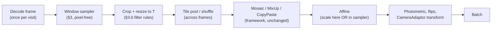

# Input Tiling

**Version:** 3.3 (draft) · **Date:** 2026-10-15 · **Author:** Sébastien Taylor · **Status:** The NumPy core, the PyTorch adaptor and the TensorFlow adaptor are implemented in `edgefirst.cameraadaptor`.

Input tiling is EdgeFirst's form of SAHI (Slicing Aided Hyper Inference and Fine-tuning) for small objects in high-resolution frames. A detector trains at a small input (the *tile*, 640×640 by default) on **native-resolution windows** of the frame, and deploys either on the whole frame (when the accelerator can take it) or on an overlapping tile grid whose detections are lifted and merged.

This document specifies the shared implementation in CameraAdaptor: the training window sampler, how it composes with a framework's augmentation pipeline, full-frame validation, and the runtime metadata contract that HAL and the EdgeFirst profiler read. Sections 3–6 are normative: every trainer that uses tiling follows them with the parameter names given here.

---

## Table of Contents

1. [Overview](#1-overview)
2. [Concepts and Terms](#2-concepts-and-terms)
3. [The Window Sampler](#3-the-window-sampler)
4. [Composition with Augmentation and Batching](#4-composition-with-augmentation-and-batching)
5. [Full-Frame Validation](#5-full-frame-validation)
6. [Runtime Contract](#6-runtime-contract)
7. [Using the Package](#7-using-the-package)
8. [Other Tasks](#8-other-tasks)
9. [Verification](#9-verification)
10. [Module Reference](#10-module-reference)
11. [Changelog](#changelog)

---

## 1. Overview

**Scope.** Object detection with axis-aligned boxes on RGB/BGR frames, for PyTorch trainers (the EdgeFirst Ultralytics trainer) and TensorFlow/Keras trainers (ModelPack). Segmentation, pose and OBB are reserved (§8).

**Package layout.**

| Module | Needs | Contents |
|---|---|---|
| `edgefirst.cameraadaptor.tiling` | NumPy only | Configuration, window sampler, epoch plan, target rules, EvenDist grid, lift and merge reference, `tiling` metadata block and its conformance checks, sampler statistics |
| `edgefirst.cameraadaptor.tiling.pixels` | `transform` extra (OpenCV) | Crop, antialiased resize and letterbox of one window |
| `edgefirst.cameraadaptor.pytorch.tiling` | `torch` extra | Grid rendering, per-tile targets and frame merge on tensors, for tiled validation |
| `edgefirst.cameraadaptor.tensorflow.tiling` | `tensorflow` extra | `tf.data` visits around the NumPy sampler, tile rendering and EXIF-aware decoding in the graph, graph target rules for a GPU mosaic, and the §5 multi-label NMS |
| `edgefirst.cameraadaptor.calibration` | NumPy only | INT8 calibration frame selection and tiled snapshot planning (§6.5) |

Importing `edgefirst.cameraadaptor.tiling` loads neither OpenCV, PyTorch nor TensorFlow, so the sampler runs in data-loader workers, inside `tf.numpy_function` or ahead of a GPU pipeline. What stays in each trainer is listed in §7.5.

**Why tile.** On VisDrone2019-DET, YOLOv8, YOLO11 and YOLO26 (n, s, m) trained on 640 tiles and deployed on the whole 1344×768 frame score 0.299–0.381 mAP50-95, against 0.287–0.370 for the same models trained on whole frames at 1280 and 0.229–0.310 trained at 640, at the same deployment input and cost. Running the tile-trained weights on the tiled grid instead (SAHI deployment) scores 0.279–0.354 at about 2.5× the latency, so whole-frame deployment is preferred whenever the accelerator fits the frame (§6.5).

---

## 2. Concepts and Terms

| Term | Meaning |
|---|---|
| **Frame** | A source image at native resolution (for example 3840×2160). |
| **Tile size** `T` | The model input size in pixels, `(T_h, T_w)`. Under tiling, a trainer's input size means the tile size, not the frame size. |
| **Window** | A rectangle in frame pixels that the sampler selects and that is resized to `T`. A window at scale `s` covers `round(s·T)` frame pixels per axis. |
| **Tile** | The `T`-sized image produced from a window, with its remapped targets. |
| **Grid** | The deterministic EvenDist tiling of a frame used at deployment and for tiled validation (§6.3). |
| **F** | Frames per batch (`frames_per_batch`): the number of distinct frames each batch of N tiles is drawn from. A frame visit yields about N/F tiles from one decode. |
| **Kind** | Why a window was chosen: `positive`, `background` or `full_frame` (§3.2). |

Tiling is a **ground-truth-aware way to turn one frame into several training samples**. It runs before the framework's own augmentation, which then treats tiles as ordinary images.

---

## 3. The Window Sampler

### 3.1 Contract

The sampler is **pixel-free**: it reads frame dimensions and targets, never pixels.

```python
sample_windows(
    frame_hw,           # (H, W) in pixels
    boxes_xyxy,         # float32 [N, 4], frame pixels
    classes,            # int32 [N]
    cfg,                # TilingConfig (§3.9)
    rng,                # numpy.random.Generator (§3.11)
    k=1,                # windows to draw when kinds is None
    phase="main",       # "main" | "final" (§3.6)
    hard_regions=None,  # optional float32 [M, 4] frame pixels (§3.4)
    valid_rect=None,    # reserved (§3.4)
    class_repeat=None,  # per-class repeat factors for class_balanced anchors
    kinds=None,         # the epoch plan's kinds for this visit (§4.2)
) -> list[Window]

Window:
    kind: "positive" | "background" | "full_frame"
    rect: (x, y, w, h)        # int frame pixels, fully inside the frame
    out_hw: (T_h, T_w)
    scale: float              # w / T_w (== h / T_h except for full_frame)
    content: (x, y, w, h) | None  # letterboxed placement on the tile (§3.7)
    targets: CropResult       # boxes, classes, clipped, ignore_boxes, drop counts
    boxes, classes            # shortcuts to targets: xyxy tile pixels after §3.8
    grid_index: int | None    # set when the window is a deployment grid tile
    fallback: bool            # a background draw that fell back to positive
```

With `kinds`, one window is drawn per entry, in order. Without it, `k` kinds are drawn from `cfg.mix` for this frame alone.

**Inputs.** `boxes_xyxy` are frame pixels of the frame as decoded (§4.3), inside the frame. The core does not clip or drop input boxes: it takes them as the Ultralytics label checks leave them, so a trainer reading its own label format applies the same checks before sampling.

The pixel stage is the caller's: crop `rect`, resize to `out_hw` with the §3.6 filter rule, and place it at `content` on a pad-filled tile when `content` is set. `tiling.pixels.render_window` does this with OpenCV. `crop_targets(rect, tile_hw, targets, rules, content)` applies §3.8 on its own, for callers that build their own windows, such as a tiled validator or anchor statistics.

### 3.2 Window kinds and mixture

The mixture is an **epoch-level tile target**. The epoch plan (§4.2) assigns each tile its kind so that the realised shares over an epoch match `mix`:

| Kind | Default share | Purpose |
|---|---|---|
| `positive` | 0.75 | A window containing a chosen *anchor object*, placed without centre bias (§3.3) |
| `background` | 0.15 | A window that intersects **no** ground-truth box (§3.4) |
| `full_frame` | 0.10 | The whole frame, antialiased down to `T` (§3.5) |

- **Per-batch allocation.** For a batch of N tiles, the background count is `B ~ Binomial(N, mix.background)` and the full-frame count is `R ~ Binomial(N − B, mix.full_frame / (mix.positive + mix.full_frame))`. The remaining `P = N − B − R` slots are positive.
- **Background frames go first.** A frame with no ground truth receives only background tiles, and each frame in a batch's group receives at least one slot. Background slots go first to the group's background frames, spread evenly across them. Background slots left over after those frames hold their share become empty-region crops in ground-truth frames, and when the group has no background frame all B slots become empty-region crops. When the group's background frames outnumber B, each still takes one slot, so that batch exceeds the background target and the statistics report the realised shares.
- **Ground-truth frames.** All of a ground-truth frame's slots (positive, full-frame and any empty-region crops) are spread over the group's ground-truth frames in proportion to each frame's ground-truth extent, the number of EvenDist grid tiles (§6.3) that its boxes intersect, at least 1. Each frame holds at most 2·N/F slots, and slots displaced by the cap move to the group's other frames.
- Shares are normalised to sum to 1. Setting a share to 0 disables that kind.
- The realised empty-tile rate also includes positives whose targets were all dropped, so the sampler reports it (§3.10).

**Why 15% background and not 50%.** In a sparse 4K frame a positive 640² tile holding one 30-pixel object is still more than 99% background pixels, and a dense detector supervises every one of them as background. Dedicated background windows only need to cover contexts the positives never reach (open sky, shoreline, glare, sensor borders). A 50% share of random windows, most of them empty, dilutes the object signal.

### 3.3 Positive placement: uniform, never centred

A positive window is placed so that the anchor object lands **uniformly anywhere** in the window, including partly across its edge, instead of dead centre. That matches deployment, where an object's position inside its grid tile is effectively uniform and 28–30% of objects are cut by some tile edge.

**Anchor choice.** Pick an object uniformly across the frame's objects (by object, not by pixel area). Within one frame visit, anchors are drawn **without replacement** from a shuffled per-visit deck; when the visit has more positive slots than objects, the deck is reshuffled and objects repeat with fresh origins. With `anchor_weighting: class_balanced`, anchors are weighted by the repeat factor of their class (§3.9).

**Placement per axis.** Let the anchor span `[b0, b1]` on an axis of frame length `L`, and let the window length be `c = min(round(s·T), L)`. The origin `o` is drawn **uniformly** from

```text
lo = max(0,     min(b1 - c, b0) - e)
hi = min(L - c, max(b0, b1 - c) + e)
o  ~ UniformInteger[ceil(lo), floor(hi)]
```

- With `e = 0`, a box smaller than the window lies fully inside it, at a uniformly random offset. A box larger than the window gives a window lying inside the box's span, which keeps its visibility as high as possible.
- `e` is the **cut extension**. With probability `cut_prob` (default 0.1) a positive window uses `e = 0.5·(b1 - b0)` on each axis where the anchor fits in the window (`b1 - b0 ≤ c`), so the anchor may cross the window edge by up to half its size, and `e = 0` on an axis where it is longer than the window, which a window inside its span already cuts. An anchor that fits keeps at least half its extent on each axis, so its visible area stays ≥ 0.25, which is exactly the default `min_visibility` (§3.8), and it always survives. An anchor longer than the window keeps `c / (b1 - b0)` of that axis, with or without the cut.
- The interval `[lo, hi]` is never empty for a box inside the frame, so no retries are needed.
- The origin is drawn uniformly over the **integers** in the interval. That keeps an `e = 0` anchor strictly inside the window, which flooring a continuous draw does not. When the interval holds no integer, the origin is `lo` rounded to the nearest pixel.
- **The origin is sampled from the feasible interval, never clamped afterwards.** Clamping a sampled origin piles probability onto the frame border and recreates a positional bias.

Objects near the frame border end up near the window border with the same probability as on the deployment grid, whose tiles also never extend past the frame. That is the correct behaviour, not a bias.

**Multi-object placement.** For each positive tile, draw `placement_candidates` (default 4) origins independently from the anchor's feasible interval and keep the window that fully contains the most ground-truth boxes, with a seeded random tie-break.

- The score counts boxes other than the anchor, so the anchor's own placement, including a cut-extension cut, is unaffected.
- Windows move toward clusters only when a cluster exists.
- A grid-snapped positive (below) likewise takes the best of `placement_candidates` randomly chosen eligible grid tiles.
- `placement_candidates: 1` reproduces the single uniform draw exactly.

**Grid snapping.** With probability `grid_prob` (default 0.25), a positive window is instead a **deployment grid tile** (§6.3, with `grid_min_overlap`) chosen among the grid tiles in which the anchor is visible and its visible area is at least `min_visibility`. Grid windows are always at `s = 1` and carry `grid_index`. They show the model the exact seams and tile positions it meets at deployment.

### 3.4 Background windows and hard negatives

A background window must intersect **no ground-truth box** (strict: zero intersection area, before any target rule is applied). A window containing a dropped sliver of an object would teach the model to suppress real objects, which a truly empty window does not.

- **Uniform background.** Draw the scale as in §3.6, draw the origin uniformly over `[0, L - c]` per axis, and accept the first window intersecting no box, within `background_max_tries` attempts (default 16). If none is found, which happens in dense frames, emit a `positive` window instead and count a `background_fallback` (§3.10).
- **Grid background.** With probability `grid_prob`, draw instead uniformly among the empty grid tiles, if there are any.
- **Hard negatives (optional).** When a frame has `hard_regions`, for example false positives from a previous checkpoint that match no ground truth, a `hard_fraction` (default 0.5) of its background windows are placed like positives (§3.3, `e = 0`) around a randomly chosen hard region. They are still rejected if they intersect ground truth, falling back to uniform background. Producing the regions is a separate mining step outside the sampler.
- **Invalid content (reserved).** Frames with letterbox bars or sensor borders may supply a `valid_rect` that background windows must lie inside. The argument is accepted and ignored in this version.

### 3.5 Full-frame windows

A `full_frame` window is the whole frame, fitted into `T` with the letterbox rule (§3.7) and an antialiased downscale. It keeps large objects and global context in training.

- Targets pass through the same rules (§3.8). At 4K→640, objects under about 12 frame pixels fall below `min_box_px` and are dropped, which is intended.
- `full_frame` windows are exempt from the scale rule: their scale is fixed by the frame size.

### 3.6 Scale

| Rule | Default | Why |
|---|---|---|
| **Native share.** A window is at exactly `s = 1` with probability `native_prob`. | 0.5 | Deployment tiles are crisp native crops. |
| **Otherwise log-uniform.** `s = exp(U(ln s_min, ln s_max))` | `(0.75, 1.333)` | Centred on 1 in log space, so apparent object size has no mean bias. |
| **Antialias every downscale.** When `s > 1`, resize with an area or antialiased filter. When `s < 1`, use bilinear. When `s = 1`, crop only. | `resize: antialias` | `tf.image.crop_and_resize` and OpenCV `INTER_LINEAR` do not antialias. |
| **No compounding.** If the framework's downstream augmentation already has a scale jitter (Ultralytics `scale`), set `native_prob = 1`. | framework-specific | Two jitters multiply. |
| **Final phase.** For the last `final_phase_epochs`, sample with `phase="final"`: `native_prob = 1`, `full_frame` share 0 (moved to positive). | 10, aligned with the framework's `close_mosaic` | Train/test scale agreement at the end of training. |

### 3.7 Frames smaller than the tile

If a frame axis is shorter than `T` on that axis, the window spans the frame on that axis. The tile is **letterboxed**: aspect preserved, content **centred**, pad value 114 on every channel. Placement follows HAL's `letterbox_rect` exactly: the fitted side is rounded half away from zero (at least 1 px) and the offset is `(T - content) // 2` per axis, so an odd remainder leaves the extra pixel at the bottom or right. Boxes are offset and scaled accordingly, and the runtime uses the same rule (`fit: letterbox`, §6.1).

For full-size windows, letterbox and stretch are identical, so the choice matters only for small frames and full-frame windows. HAL's own default is stretch, which is why the metadata carries `fit` explicitly.

### 3.8 Target rules

`crop_targets` applies these in order, once per window, in tile pixels:

1. **Translate and clip** each box to the window, then scale by `T / c` (and place on the letterbox content when set).
2. **Visibility.** Drop a box whose clipped area is below `min_visibility` (default 0.25) of its original area.
3. **Pixel floor.** Drop a box whose shorter side in tile pixels is below `min_box_px` (default 2).
4. **Truncation mode.**
   - `drop` (default): steps 2–3 decide.
   - `keep`: keep every box with any visible area. For ablations only.
   - `ignore`: boxes failing step 2 but with visibility ≥ `ignore_visibility` (default 0.05) are returned in a separate `ignore_boxes` array. Frameworks without an ignore concept fill those regions with the pad value.
5. **Order and cap.** Keep the input order and cap at `max_boxes` if the framework needs fixed shapes. Report truncation by the cap.

A box counts as **clipped** when step 1 changed it. The clipped-box share is a reported statistic (§3.10); with mosaic on it should approach the 28–30% seen at deployment.

### 3.9 Configuration

`TilingConfig` is the one configuration shared by all implementations. Names are normative, and trainers map their own YAML or CLI surfaces onto them. `TilingConfig.from_dict` accepts nested mappings or dotted keys (`"mix.positive"`), rejects unknown keys and validates ranges; `to_dict` round-trips.

| Parameter | Default | Notes |
|---|---|---|
| `enabled` | false | |
| `tile_size` | (640, 640) | `(H, W)` or one int for a square tile |
| `frames_per_batch` (F) | 4 | Frames each batch of N tiles is drawn from; a frame contributes about N/F tiles (§4.2). F = N gives a tiled epoch the optimiser steps of a whole-frame epoch. |
| `epoch_mode` | `frames` | `frames` or `tiles` (§4.2) |
| `mix.positive` / `mix.background` / `mix.full_frame` | 0.75 / 0.15 / 0.10 | §3.2 |
| `grid_prob` | 0.25 | §3.3, §3.4 |
| `grid_min_overlap` | 0.1 | EvenDist `min_overlap` of the grid used for snapping and for the frame's ground-truth extent; written to the metadata as `grid.min_overlap` (§6.1) |
| `cut_prob` | 0.1 | §3.3 |
| `placement_candidates` | 4 | Candidate origins per positive tile (§3.3) |
| `anchor_weighting` | `uniform` | `uniform` or `class_balanced` |
| `background_max_tries` | 16 | §3.4 |
| `hard_fraction` | 0.5 | Used only when hard regions exist |
| `scale.native_prob` | 0.5 | Set to 1 when the framework has its own scale jitter (§3.6) |
| `scale.range` | (0.75, 1.333) | Log-uniform; must bracket 1 |
| `resize` | `antialias` | `antialias` or `bilinear` |
| `final_phase_epochs` | 10 | §3.6 |
| `targets.min_visibility` | 0.25 | §3.8 |
| `targets.min_box_px` | 2 | §3.8 |
| `targets.truncation` | `drop` | `drop`, `keep` or `ignore` |
| `targets.ignore_visibility` | 0.05 | Lower edge of the ignore band |
| `targets.max_boxes` | none | Cap for fixed-shape targets |
| `class_balance` | `none` | Only `none`. Frame-level repeat-factor sampling (`rfs`) is reserved and rejected until the epoch plan implements it; `rfs_t` (default 0.001) is its threshold. Class-balanced anchors use `anchor_weighting` with factors from `repeat_factors` |
| `seed` | 0 | Set from the trainer seed (§3.11) |

`SPEC_VERSION` (`"3.3"`) is the sampler specification version recorded in the metadata `training` record (§6.1). It changes only when sampled windows change.

### 3.10 Sampler statistics

`SamplerStats` accumulates per-window statistics in a flat float64 vector, so data-loader workers can sum into shared memory, and `summary()` turns it into per-epoch values. `EpochPlan.summary()` adds the plan's view. Trainers log both each epoch.

| Statistic | Expectation |
|---|---|
| `positive_share`, `background_share`, `full_frame_share` | Within ±2% of `mix` on frames with ground truth |
| Background share drift | Warn when it differs from `mix.background` by more than 0.05, naming the cause: background frames at one tile each and the 2·N/F per-frame cap, or `fallback_rate` on dense frames. Datasets without empty frames realise a low background share. |
| `fallback_rate` | Low; high values mean a dense dataset, so lower `mix.background` |
| `clipped_share` | Approaches deployment's 28–30% with mosaic on |
| `native_share` | About `native_prob`; 1 in the final phase |
| `empty_rate`, `boxes_per_tile`, `objects_per_positive_tile`, `dropped_*_per_tile`, `decodes_per_sample` | Informational |
| `anchor_histogram()` (8×8, tile coordinates) | Flat away from the frame border |
| `objects_histogram()`, `scale_histogram()` | Informational. The scale histogram bins `ln(1/s)`, the apparent object scale, over resampled windows only (native windows are counted by `native_share`); it is symmetric around 0 |
| `tiles_per_frame_mean` / `min` / `max`, `background_frame_share`, `planned_*_share` (from the plan) | The plan's allocation before any fallback |

### 3.11 Determinism

Given `(seed, epoch, frame_index, call_index)` the sampler is deterministic. `make_rng(seed, epoch, frame_index, call_index)` derives a `numpy.random.Generator` from `numpy.random.SeedSequence` for each visit; the global NumPy RNG is never used. Tests can reproduce a window exactly, and a data-loader worker restart does not change the stream.

**The epoch travels with the sample index, not through shared state.** Data-loader workers prefetch across epoch boundaries, so a worker that reads a shared epoch counter set at epoch start draws the first batches of epoch *e* with epoch *e − 1*. The training sampler runs in the main process and knows the true epoch, so it yields `epoch · M + i` for item `i` of `M`, and the dataset recovers `(epoch, i)` with `divmod`; sampler statistics are recorded against that epoch. `call_index` is 0 for all of a frame visit's windows, which come from one generator in slot order.

---

## 4. Composition with Augmentation and Batching

### 4.1 Pipeline order



**Mosaic runs on tiles.** A mosaic of four native-scale tiles keeps small objects at deployment scale. Its random crop of the 2×2 canvas also creates seams through objects, which is the truncation that deployment grids produce. Mosaic stays on under tiling and turns off in the final phase, as it does without tiling.

**CameraAdaptor transforms run last.** Tiling is format-agnostic and operates on RGB/BGR frames before any colour-space conversion.

### 4.2 The epoch

Epoch-denominated schedules must keep their meaning: learning-rate warmup and decay, `close_mosaic`, patience and EMA horizons.

| `epoch_mode` | Dataset length | Use |
|---|---|---|
| `frames` | The epoch plan's tile count, about M·N/F for batch N, M frames and F frames per batch. Every frame is visited once per epoch, N/F tiles each (cap 2·N/F). | **Default.** An epoch is one pass over the frames. |
| `tiles` | A fixed tile count per epoch, independent of the frame count | Legacy; epoch counts and step-based schedules must be scaled to the tile count. |

**The epoch plan.** `plan_epoch(extents, batch, cfg, epoch, final)` is a pure function of `(seed, epoch)` and the frames' ground-truth extents (`gt_extent`):

1. Split the M frames into ground-truth and background frames, shuffle each with the epoch seed, and interleave them evenly so every batch's ground-truth to background frame ratio matches the dataset.
2. Cut the order into ⌈M/F⌉ groups of F consecutive frames; the last group may be smaller.
3. Each group becomes one batch of N tiles, allocated as in §3.2 and capped at 2·N/F tiles per frame, with displaced slots moving to the group's other frames. Slots are spread in proportion to the frames' weights, each frame holding between 1 and the cap: the remaining slots are first floored in proportion to the weights of the frames still under the cap, and when flooring adds nothing the next slot goes to the frame with the largest remainder, with a seeded tie-break.

`final=True` applies the final-phase mixture (§3.6). A visit draws all of its frame's windows in slot order from the frame's generator (`EpochPlan.kinds(frame)`), so the plan does not depend on worker count.

### 4.3 Decode amortisation and shuffling

A 4K JPEG decode costs tens of milliseconds on a CPU core and dominates the pipeline. So:

- Decode each frame once per visit: its N/F planned tiles for the batch come from one decode.
- **Shuffle across frames before batching,** so that tiles from one frame do not cluster. In tf.data, interleave about 16 frames before the shuffle buffer. In PyTorch, serve mosaic partners from a pool of tiles rendered on earlier visits rather than decoding more frames.
- A batch holds tiles from F distinct frames (F is clamped to the batch size). Mosaic and MixUp partners add tiles from earlier visits, so a sample's batch context spans more frames than F.
- **Decode with EXIF orientation applied,** as OpenCV `imread` does; labels refer to the oriented frame. A decoder that ignores EXIF (TensorFlow's) applies `tiling.exif.orientation` itself, and `oriented_hw` gives the decoded size without decoding, for planning and calibration.
- **Never cache resized frames.** A cache of frames resized to `T` defeats native-scale cropping, and a cache of native 4K frames does not fit in memory.
- **Region decode (optional).** A decoder that decodes only the rows or MCUs covering a visit's windows cuts CPU cost several-fold. Pixels must be bit-identical to a full decode followed by a crop.

---

## 5. Full-Frame Validation

A tile-trained model is scored on **full frames**, the deployment metric, never per tile. Two modes are defined:

| Mode | How | Cost | When |
|---|---|---|---|
| `whole_frame` | Run the model once on the frame letterboxed (centred, §3.7) into the deployment input, for example 1360×765 into 1344×768. One class-aware NMS at IoU 0.7. | About one forward pass of the input area | The model deploys whole-frame |
| `tiled` | EvenDist grid (§6.3) → per-tile model → per-tile class-aware NMS at IoU 0.5 → lift → cross-tile merge (IoS 0.5, class-aware, keep-best, `max_det` 300) | About `n_tiles` passes | The model deploys tiled, or to confirm tiled parity with the runtime |

**Validation runs at the deployed geometry, on every frame.** A tiled training session validates in `tiled` mode over the whole validation split each epoch, and those numbers select the best checkpoint. Whole-frame accuracy of the same weights comes from validating an export at its whole-frame geometry (§6.5). Validating on a per-epoch subset selects the wrong checkpoint and is not used. Tiling never applies to validation data: the validation set is frames.

**Batching.** Validation batches tiles, not frames.

- **Tile budget.** Tiles from consecutive frames are gathered into batches of up to a tile budget and run through the model once per batch. The default budget is twice the training batch. `frames_per_batch(frame_shapes, tile_hw, min_overlap, tile_budget)` sizes frame batches by the shape with the most grid tiles, so mixed-resolution splits never exceed the budget.
- **Merging.** Per-tile predictions are split back by frame and each frame is merged once all of its tiles have been scored.
- **Equivalence.** Results must equal one-frame-at-a-time validation within the floating-point differences between batch sizes.
- **During training,** validation runs on the model already in memory (EMA weights, no gradients, training precision), so a budget of twice the training batch fits wherever training fits.

**Protocol.** Trainer, profiler and Ultralytics `val` numbers are comparable only under one protocol, which every validator follows:

| Setting | Value |
|---|---|
| Score floor | 0.001 (`per_tile.score`) |
| Labels per box | **Multi-label**: one box per class above the floor, as Ultralytics `val` does |
| NMS | Class-aware; IoU 0.7 on whole frames, IoU 0.5 per tile (`per_tile.iou`), because the keep-best IoS merge does not group same-object duplicates that overlap between those values |
| Pre-NMS candidates | Top 30,000 |
| `max_det` | 300 (`TILING_MAX_DET`, the exported `merge.max_det`) |
| Matching | Highest-confidence detection per ground truth (Ultralytics `match_predictions`); COCO-style AP from the profiler agrees within about 0.003 mAP50-95 |

`tiling.nms_multilabel` is the NumPy reference of this NMS (the `PROTOCOL_*` constants hold its settings) and reproduces Ultralytics `non_max_suppression(multi_label=True)`; `tensorflow.tiling.nms_multilabel` is the same in fixed shapes. `tiling.merge_frame_detections` lifts, merges and clips one frame's per-tile detections.

**Rules for comparable numbers:**

- The Python grid, lift and merge are a reference of HAL's and must match it on the golden vectors (§9).
- Report the protocol with every number: multi-label, IoU, `max_det` and input geometry.
- **Preprocessing parity.** Runtime validation must letterbox exactly as the trainer does. Confirm GPU and CPU preprocessing parity on the host before publishing whole-frame numbers.

---

## 6. Runtime Contract

### 6.1 The `tiling` metadata block

Trainers write this block into the model's embedded EdgeFirst metadata, alongside the existing groups. HAL and the EdgeFirst profiler read it. The block carries **parameters and algorithm versions**, not a list of rectangles, and each runtime expands the grid for its own frame size.

```yaml
tiling:
  version: 1
  mode: tiled                    # tiled | whole_frame — binding, fixed at export
  tile: [640, 640]               # runtime tile [H, W]; equals the input H, W when mode = tiled
  grid:
    algorithm: evendist
    version: 1
    min_overlap: 0.1             # ratio, minimum; realised overlap is >= this
  fit: letterbox                 # letterbox | stretch; identical for full-size tiles
  pad: [114, 114, 114]
  per_tile:
    nms: class_aware             # class_aware | class_agnostic | none (end-to-end heads)
    iou: 0.5
    score: 0.001
  merge:
    mode: keep_best              # keep_best | union
    metric: ios                  # ios | iou
    threshold: 0.5
    class_agnostic: false
    max_det: 300
  full_frame:
    enabled: false               # optional extra whole-frame pass merged with the tiles
    own_above_area: 0.02         # full-frame boxes own objects above this fraction of frame area
  training:                      # how the weights were trained; copied unchanged by later exports
    session: t-1a2b
    sampler: edgefirst-tiling
    version: "3.3"               # SPEC_VERSION of the sampler
    params: {}                   # the §3.9 configuration as trained
  export:                        # how this model was produced
    session: t-3c4d
    weights_from: t-1a2b         # omitted when the same session trained and exported
    calibration: {resize: tiled, input_shape: [640, 640], full_frame: false}
  # reserved for later tasks (§8): masks, semantic, keypoints, obb
```

`build_tiling_block(cfg, session=...)` builds the block for a model exported by the session that trained it, and `reexport_tiling_block` builds it for an export-only session from the source model's block, copying its `training` record. `validate_tiling_block` checks a block before it is embedded; `tests/fixtures/tiling_contract.json` holds the conformance cases.

Unknown keys are ignored. A runtime that finds a `version` greater than it supports falls back to no tiling and logs a warning. The published contract, with field descriptions, is the EdgeFirst user manual (`models/metadata.md`, "Tiling").

### 6.2 Runtime behaviour

| Case | Runtime behaviour |
|---|---|
| No `tiling` block | No tiling unless the application forces it |
| `mode: tiled` | Tile every frame on the metadata grid with the metadata fit, per-tile and merge settings |
| `mode: whole_frame` | Letterbox the whole frame into the input and run once; tile only if the application forces it, using the block's grid, per-tile and merge settings |
| Application flags (profiler `--sahi`, API overrides) | Explicit flag → metadata → built-in default, per key |

The `tiling` block is an additive, optional field of the metadata schema. The legacy `validation.tiled_*` keys are retired: trainers do not emit them and runtimes do not read them. The EdgeFirst profiler reads the block; applications built directly on HAL configure tiling themselves until HAL parses it.

### 6.3 Grid (EvenDist v1)

Per axis, for frame length `L`, tile length `t` and minimum overlap `r`:

```text
if L <= t:  origins = [0]                      # single tile spanning the frame, fitted per `fit`
else:
    max_step = max(1, floor((1 - r) * t))
    n        = ceil((L - t) / max_step)
    origins  = [round(i * (L - t) / n) for i in 0..n]   # n + 1 tiles
```

**Exact arithmetic**, which `axis_origins` reproduces to match HAL bit for bit:

- `r` is stored as float32 and widened to float64 before `(1 - r) * t` (so 0.1 becomes 0.10000000149…).
- The origin is computed in **float32**: `float32(i) * float32(L - t) / float32(n)`.
- Rounding is half away from zero (Rust `f32::round`), not Python's banker's rounding.

Tiles are ordered row-major, top-left first (`tile_grid`). Golden vectors:

| L | t | r | Origins |
|---|---|---|---|
| 1920 | 640 | 0.1 | `[0, 427, 853, 1280]` |
| 3840 | 640 | 0.2 | `[0, 457, 914, 1371, 1829, 2286, 2743, 3200]` → 32 tiles for 4K |
| 2160 | 640 | 0.2 | `[0, 507, 1013, 1520]` |
| 1920 | 640 | 0.0 | `[0, 640, 1280]` |
| 641 | 640 | 0.2 | `[0, 1]` |
| 640 | 640 | any | `[0]` |
| 400 | 640 | any | `[0]`, fitted per `fit` |
| 3840 | 640 | 0.1 | `[0, 533, 1067, 1600, 2133, 2667, 3200]` |
| 2160 | 640 | 0.1 | `[0, 507, 1013, 1520]` → 28 tiles for 4K |

HAL's own default overlap is 0.2; this specification defaults to 0.1. The runtime uses the metadata value.

### 6.4 Lift and merge

- **Lift** (`lift_tile_boxes`): `frame_xy = origin + (tile_xy - letterbox_offset) / letterbox_scale`, computed in float32 from boxes normalised `[0, 1]` over the model input. Only the letterbox un-padding clamps (to the tile's content region); lifted boxes are **not** clipped to the frame, as in HAL. Validators clip to the frame after the merge.
- **Merge** (`merge_tiled_detections`): greedy, in descending score order with ties in input order. A kept box suppresses every unprocessed box of the same class (unless `class_agnostic`) whose `metric` is at least `threshold`. `keep_best` keeps the claiming box unchanged; `union` replaces it with the enclosing box of its group at the group's maximum score. IoS is intersection over the smaller area. The loop stops once `max_det` boxes are kept, with output identical to merging every box and truncating.
- **Full-frame pass** (optional): its boxes above `own_above_area` of the frame area replace overlapping tile boxes, and tile boxes own everything below.

### 6.5 Deployment modes and export

| Mode | Export input | INT8 calibration data | Notes |
|---|---|---|---|
| Whole-frame | The camera resolution with both sides at multiples of 32, as close to native as possible (1360×765 → 1344×768, 1080p → 1920×1088, 4K → 3840×2176) | Full frames letterboxed to the export size | Preferred when the accelerator fits the frame: the most accurate deployment of tile-trained weights and about 2.5× the throughput of tiled on VisDrone |
| Tiled | Tile size | **Grid tiles** of calibration frames at native scale, not letterboxed full frames | Calibrating a tile model on downscaled 4K frames gives activation ranges from the wrong distribution |

Both modes use the same weights, because the detectors are fully convolutional and trained at native scale. Each export produces one mode. A tile-trained session exports `tiled` at its tile size. Any other geometry (whole-frame at a camera resolution, or tiled at another tile size) comes from an export-only session that loads the trained weights and exports and calibrates at the requested geometry without retraining; its deployment mode defaults to `whole_frame`, and it copies the source's `training` record.

**Whole-frame export size.** Each side must be a multiple of 32, the backbone stride, and an export fails early rather than rounding silently. A width that is not a multiple of 64 should log a warning, because 3-byte RGB rows are then not 64-byte aligned, which Mali GPU preprocessing requires. Frames of other sizes are letterboxed into the input by the runtime.

**Calibration snapshots.** Frame selection is the same in both modes: `max_dynamic_range_v1`, model-free and computed from source-pixel statistics over the training split (`edgefirst.cameraadaptor.calibration`). The modes differ in what each selected frame contributes:

| Mode | Sample per selected frame | Snapshot parameters |
|---|---|---|
| Whole-frame | The frame letterboxed to the export size | `resize: letterbox`, `input_shape` = export size |
| Tiled | Deployment-grid tiles of the frame at native scale: the tiles holding the pool extrema for frames selected for them, otherwise one seeded tile per frame, plus further distinct seeded tiles spread evenly over frames when the pool has fewer frames than the sample count; frames smaller than the tile are letterboxed as in §3.7 | `resize: tiled`, `selection: max_dynamic_range_tiled_v1`, `grid: {algorithm: evendist, version: 1, min_overlap}`, `input_shape` = tile size |

The `grid` block is part of the snapshot parameter hash, so tiled and letterbox snapshots never share a cache entry. `check_snapshot_params`, `check_snapshot_geometry` and `check_converter_tiling` are the reference checks for converters. `calibration.select_max_dynamic_range` selects the frames, `calibration.extremum_positions` gives the extremum pixels of seeded frames, and `calibration.plan_tile_samples` plans a tiled snapshot's tiles from the frames' decoded sizes; decoding, and therefore EXIF orientation, is the trainer's. A 4K whole-frame snapshot of 500 samples holds about 12.5 GB of padded frames, against about 0.6 GB for 500 grid tiles of 640².

---

## 7. Using the Package

```bash
pip install edgefirst-cameraadaptor              # NumPy core
pip install "edgefirst-cameraadaptor[transform]" # + render_window (OpenCV)
pip install "edgefirst-cameraadaptor[torch]"     # + PyTorch adaptor
```

### 7.1 Training: plan, sample, render

```python
import numpy as np

from edgefirst.cameraadaptor.tiling import (
    SamplerStats,
    TilingConfig,
    gt_extent,
    make_rng,
    plan_epoch,
    sample_windows,
)
from edgefirst.cameraadaptor.tiling.pixels import render_window

cfg = TilingConfig.from_dict(
    {"enabled": True, "tile_size": 640, "frames_per_batch": 4, "seed": 7}
)

# frames: list of HxWx3 uint8; boxes: list of [N, 4] xyxy frame pixels;
# classes: list of [N] int
extents = [
    gt_extent(f.shape[:2], b, cfg.tile_size, cfg.grid_min_overlap)
    for f, b in zip(frames, boxes, strict=True)
]
plan = plan_epoch(extents, batch=16, cfg=cfg, epoch=epoch)

stats = SamplerStats()
for i, frame in enumerate(frames):  # in a real loader: one visit per frame
    windows = sample_windows(
        frame.shape[:2],
        boxes[i],
        classes[i],
        cfg,
        make_rng(cfg.seed, epoch, i, 0),
        kinds=plan.kinds(i),
    )
    for w in windows:
        stats.record(w)
        tile = render_window(frame, w.rect, w.out_hw, w.content, cfg.resize)
        # tile: T_h x T_w x 3; w.boxes (xyxy tile pixels) and w.classes
        # go to the framework's augmentation pipeline.

print(stats.summary(), plan.summary())
```

`plan.tiles` lists every planned tile in batch order (`frame`, `slot`, `kind`) and `plan.batches` the tile count of each batch, which is what a framework sampler iterates. In the last `cfg.final_phase_epochs` epochs, pass `final=True` to `plan_epoch` and `phase="final"` to `sample_windows`.

### 7.2 Tiled inference and validation

```python
import numpy as np

from edgefirst.cameraadaptor.tiling import (
    lift_tile_boxes,
    merge_tiled_detections,
    tile_grid,
)

lifted, scores, labels = [], [], []
for p in tile_grid(frame.shape[:2], (640, 640), min_overlap=0.1):
    # Render p.rect at p.content (render_window), run the model, apply
    # per-tile NMS (§5); boxes are normalised [0, 1] over the tile.
    b, s, c = detect(tile_for(p))
    lifted.append(lift_tile_boxes(b, p))
    scores.append(s)
    labels.append(c)

boxes, scores, labels = merge_tiled_detections(
    np.concatenate(lifted),
    np.concatenate(scores),
    np.concatenate(labels),
    metric="ios",
    threshold=0.5,
    mode="keep_best",
    max_det=300,
)
```

Use the values from the model's `tiling` block (§6.1) rather than literals when one is present.

### 7.3 PyTorch adaptor

`edgefirst.cameraadaptor.pytorch.tiling` works on a frame already loaded on the device, placed at `pad_xy` inside a letterboxed validator input:

| Function | Purpose |
|---|---|
| `plan_frame(frame_hw, pad_xy, tile_hw, min_overlap)` | `FramePlan`: the frame's grid (§6.3) and its position in the validator input |
| `render_tiles(img, plan, pad_value=114/255)` | `[n_tiles, C, T_h, T_w]` tensor of native crops, letterboxed where the frame is smaller than the tile |
| `tile_targets(frame_boxes, classes, plan, rules)` | Per-tile targets (§3.8) in Ultralytics batch layout (`batch_idx`, `cls`, normalised xywh) |
| `merge_frame(per_tile, plan, max_det=300, device)` | Lifts per-tile detections (`boxes`, `scores`, `classes`), merges them (§6.4) and returns frame detections in validator-input pixels |

Training tiles in PyTorch are rendered on the CPU in data-loader workers with the NumPy core and `render_window`, because mosaic and the other CPU augmentations need the tile pixels there.

### 7.4 TensorFlow adaptor

`edgefirst.cameraadaptor.tensorflow.tiling` keeps window choice in the NumPy core and pixels in the graph. A `tf.data` pipeline iterates the epoch's visits; each visit calls the sampler through `tf.numpy_function` and gets static shapes back, so the windows are those the PyTorch trainer draws for the same seed.

```python
import tensorflow as tf

from edgefirst.cameraadaptor.tensorflow import tiling as tft
from edgefirst.cameraadaptor.tiling import TilingConfig, plan_epoch

cfg = TilingConfig.from_dict({"tile_size": 640, "targets.max_boxes": 100})
plan = plan_epoch(extents, batch=16, cfg=cfg, epoch=epoch)
frames, kinds = tft.visit_arrays(plan)
visit = tft.visit_fn(cfg, frame_hw, lambda i: (boxes[i], classes[i]), 100)


def load(frame, codes):
    geometry, targets, stats = tft.visit_windows(
        visit, epoch, frame, codes, final, max_boxes=100
    )
    image = tft.decode_frame(tf.io.read_file(tf.gather(paths, frame)))
    tiles = tft.render_windows(image, geometry, cfg.tile_size, cfg.resize)
    return tiles, targets, stats


tiles = tf.data.Dataset.from_tensor_slices((frames, kinds)).map(load)
```

| Op | Shapes | Notes |
|---|---|---|
| `visit_arrays(plan)` | `frames int64[V]`, kind codes `int32[V, None]` | One element per frame visit, in batch order (`EpochPlan.visits()`) |
| `visit_fn` + `visit_windows` | `int32[n, 8]` geometry, `float32[n, max_boxes, 5]` targets, `float64[SamplerStats.SIZE]` | Geometry is `pack_geometry`'s `(x, y, w, h, left, top, cw, ch)`; targets are `pack_targets`' normalised `(cx, cy, w, h, class)`, padded with −1. Each visit returns its statistics vector for the caller to sum, so no state is shared across workers. `targets.truncation` must be `drop` or `keep`, since packed targets carry no ignore regions |
| `decode_frame(data)` | `uint8[H, W, 3]` RGB | EXIF orientation applied as OpenCV does (§4.3) |
| `render_windows(image, geometry, tile_hw, resize)` | `uint8[n, T_h, T_w, 3]` | Same-size crops copied unchanged; downscales use area filtering for `antialias`, everything else bilinear (§3.6); within rounding of `tiling.pixels.render_window`. Grid tiles render the same way from `pack_placements` |
| `crop_targets(boxes, classes, valid, rect, tile_hw, rules, content)` | Batched padded boxes in, compacted boxes and mask out | §3.8 for a GPU mosaic, matching the core; `truncation="ignore"` is not supported |
| `nms_multilabel(boxes, scores, iou)` | `[B, max_det]` padded detections and a count | The §5 protocol NMS, suppressing within each class on the boxes as given, so pixel and normalised coordinates both work |

The epoch must travel with the dataset element (§3.11): build each epoch's dataset from its own plan, or carry the epoch in the element. Tiled validation renders `pack_placements(tile_grid(...))`, runs the model and `nms_multilabel` at the per-tile IoU, and merges each frame with `tiling.merge_frame_detections`.

### 7.5 What stays in each trainer

The shared package holds everything that defines *which* windows are drawn and *how* detections are scored and exported. Each trainer keeps the parts that depend on its framework's internals:

- **Dataset and loader:** the epoch sampler that yields `epoch · len + p` (§3.11), the visit cache that serves a frame's planned tiles from one decode, the mosaic partner pool, and the forced settings: no image cache, and `scale.native_prob = 1` when the framework has its own scale jitter (§3.6).
- **Final phase:** the switch to `phase="final"` together with the framework's mosaic close.
- **Validator:** the framework's validator subclass that batches tiles under the budget (§5) and feeds frame-level predictions to its metrics.
- **Export:** the deployment mode, export geometry, the `tiling` block (§6.1) and calibration snapshots (§6.5).
- **Statistics:** logging `SamplerStats.summary()` and `EpochPlan.summary()` each epoch, with the background-drift warning (§3.10).

---

## 8. Other Tasks

Nothing here is implemented. These are the extension points that must not be closed off.

| Task | Sampler (§3) | Runtime (§6) |
|---|---|---|
| **Instance segmentation** | Clip polygons geometrically, then re-derive the box from the clipped geometry. The survival decision is made once per instance on geometry-area retention, and box and mask survive or drop together. `crop_targets` gains `segments` in and out. | Prototype masks are tile-local and never stitched. Keep masks box-local and lift them with the box affine. Candidates come from the box IoS merge and are confirmed by mask overlap. Metadata key `masks`. |
| **Semantic segmentation** | Windows over the label map; pad pixels become `ignore_index` (255). | Overlap blending of logits (uniform, Gaussian or hard-crop window). Metadata key `semantic`. |
| **Pose** | Keypoints outside the window get visibility 0. | Per-keypoint best-source selection. Metadata key `keypoints`. |
| **OBB** | Rotated clipping, IoF-based survival. | Isotropic lift only (`fit: letterbox`) and a rotated-IoU merge. Metadata key `obb`. |

**Reserved now:**

- `crop_targets` takes a `targets` mapping (`boxes`, `classes`); passing `segments`, `keypoints` or `masks` raises `NotImplementedError` rather than silently dropping them.
- Metadata keys `masks`, `semantic`, `keypoints` and `obb` are reserved inside `tiling`.
- Evaluation is always on stitched full frames, with mask area used for size buckets.

---

## 9. Verification

**Golden vectors** (`tests/fixtures/tiling_golden.json`): EvenDist origins for the §6.3 table plus randomised `(L, t, r)` cases, lift cases including letterboxed small frames, and merge cases (IoS against IoU on seam fragments, keep-best against union, class-aware against agnostic, nested same-class boxes, `max_det` truncation). `tests/tiling/gen_golden_from_hal.py` regenerates the random cases from HAL's Python bindings, which are the source of truth for geometry. The reference must match HAL exactly on geometry and within 1e-5 on lifted coordinates.

**Contract cases** (`tests/fixtures/tiling_contract.json`): valid and invalid `tiling` blocks, snapshot parameters and converter inputs for §6.

**Sampler tests** (`tests/tiling/`):

| Test | Pass condition |
|---|---|
| Determinism | The same `(seed, epoch, frame, call)` gives identical windows |
| Containment | Every `rect` lies inside the frame; every output box lies inside `[0, T]` |
| No centre bias | For one small object far from the frame edges, the anchor-centre position within the tile over 10⁴ draws is uniform (8×8 histogram, χ² p > 0.01) |
| No border pile-up | For an object touching the frame edge, no single origin value carries more than 2/n of the mass |
| Background emptiness | No `background` window intersects any ground-truth box |
| Mixture | Realised kind shares track `mix` at the epoch level within ±2%, including a third of the frames being empty |
| Epoch plan | Every frame is visited exactly once per epoch; each batch's slots sum to N; no frame exceeds 2·N/F slots; the plan is identical for a given `(seed, epoch)` |
| Placement candidates | The cut rate with `placement_candidates` = 4 matches 1; with 1 the single draw is reproduced exactly |
| Cut extension | With `cut_prob = 1`, anchor visibility is always ≥ 0.25 and sometimes < 1 |
| Scale | About half the windows at exactly `s = 1`; `ln s` symmetric; the final phase gives only `s = 1` |
| Target rules | Visibility and pixel-floor edges (exactly 0.25, exactly 2 px) behave as specified |
| Small frames | A frame smaller than `T` gives one window, letterboxed, with correct box transforms |
| Isolation | Importing the core loads neither OpenCV, PyTorch nor TensorFlow, and the core imports only the standard library and NumPy |

The tiling tests that need OpenCV or PyTorch skip when the extra is missing, so `pytest tests/tiling` checks the core in an environment with NumPy only.

---

## 10. Module Reference

| Module | Public API |
|---|---|
| `tiling.config` | `TilingConfig`, `Mix`, `ScaleConfig`, `TargetRules`, `KINDS`, `SPEC_VERSION` (§3.9) |
| `tiling.sampler` | `sample_windows`, `Window`, `make_rng`, `repeat_factors` (§3.1–§3.7, §3.11) |
| `tiling.targets` | `crop_targets`, `CropResult`, `window_transform` (§3.8) |
| `tiling.plan` | `plan_epoch`, `EpochPlan`, `PlannedTile`, `PlannedVisit`, `batch_layout`, `gt_extent` (§4.2) |
| `tiling.packing` | `pack_geometry`, `pack_placements`, `pack_targets`, `GEOMETRY_FIELDS` (§7.4) |
| `tiling.nms` | `nms_multilabel`, `PROTOCOL_IOU_WHOLE_FRAME`, `PROTOCOL_IOU_PER_TILE`, `PROTOCOL_SCORE_FLOOR`, `PROTOCOL_MAX_CANDIDATES` (§5) |
| `tiling.exif` | `orientation` (exported as `exif_orientation`), `oriented_hw` (§4.3) |
| `tiling.stats` | `SamplerStats` (§3.10) |
| `tiling.grid` | `axis_origins`, `tile_grid`, `TilePlacement`, `letterbox_rect`, `fit_content`, `frames_per_batch` (§3.7, §5, §6.3) |
| `tiling.merge` | `lift_tile_boxes`, `merge_tiled_detections`, `merge_frame_detections` (§5, §6.4) |
| `tiling.metadata` | `build_tiling_block`, `reexport_tiling_block`, `training_record`, `export_record`, `SAMPLER`, `TILING_MAX_DET` (§6.1) |
| `tiling.contract` | `validate_tiling_block`, `check_snapshot_params`, `check_snapshot_geometry`, `check_converter_tiling`, `model_input_hw`, `parse_session_id`, `ContractError`, `UnsupportedVersion` (§6.1, §6.5) |
| `tiling.pixels` | `render_window` (§3.6, §3.7; `transform` extra) |
| `pytorch.tiling` | `plan_frame`, `FramePlan`, `render_tiles`, `tile_targets`, `merge_frame` (§7.3; `torch` extra) |
| `tensorflow.tiling` | `visit_arrays`, `visit_fn`, `visit_windows`, `decode_frame`, `render_windows`, `crop_targets`, `nms_multilabel`, `KIND_CODES` (§7.4; `tensorflow` extra) |
| `calibration` | `image_descriptor`, `pool_descriptors`, `select_max_dynamic_range`, `extremum_positions`, `plan_tile_samples`, `TileSample`, `SELECTION_ALGORITHM`, `TILED_SELECTION_ALGORITHM` (§6.5) |

Every name in the `tiling.*` rows except `tiling.pixels` is also exported from `edgefirst.cameraadaptor.tiling`.

---

## Changelog

- **3.3** (draft, 2026-10-15) — The specification now documents the shared CameraAdaptor implementation: `edgefirst.cameraadaptor.tiling` (NumPy) and `edgefirst.cameraadaptor.pytorch.tiling`, with usage examples (§7) and a module reference (§10). Trainer-specific implementation plans, HAL GPU preprocessing plans and experiment tracking are removed. The cut extension applies only on an axis where the anchor fits in the window, so an oversized anchor is never left out of its window, and grid snapping requires the anchor to be visible even when `min_visibility` is 0. Both change sampled windows in those cases, so `SPEC_VERSION` becomes `"3.3"`.
- **3.2** (draft, 2026-10-08) — Validation runs at the deployed geometry on every frame, and one multi-label protocol (IoU 0.7 whole frame, 0.5 per tile, `max_det` 300, 30,000 candidates) replaces the single-label rule. Whole-frame export sizes must be multiples of 32, and export-only sessions default to `whole_frame`. Validation batches tiles across frames up to a tile budget and reuses the in-memory model.
- **3.1** (draft, 2026-10-01) — Mixture is an epoch-level tile target. The `frames` epoch visits every frame once, with `frames_per_batch` frames per batch of N tiles, stratified grouping and a 2·N/F per-frame cap. Positive placement takes the best of `placement_candidates`, scored on boxes other than the anchor. Mosaic partners come from earlier visits. A background-drift warning replaces the empty-tile warning.
- **3.0** (draft, 2026-09-27) — Framework-neutral specification: explicit kind mixture with strictly empty background windows; uniform, unclamped positive placement with cut extension and grid snapping; native-share log-uniform scale with antialiasing and a final native phase; full-frame windows; stricter target rules; seeded determinism; sampler statistics; mosaic on tiles; `epoch_mode`; whole-frame validation; the versioned `tiling` metadata block.
- **2.0** (2026-09-04, ModelPack) — Keep-best merge; per-tile floor 0.001 and overlap 0.1; whole-frame deployment of tile-trained models.
- **1.1** (2026-06-25, ModelPack) — Per-tile score floor; EvenDist grid aligned with HAL.
- **1.0** (2026-06-24, ModelPack) — Initial specification.
